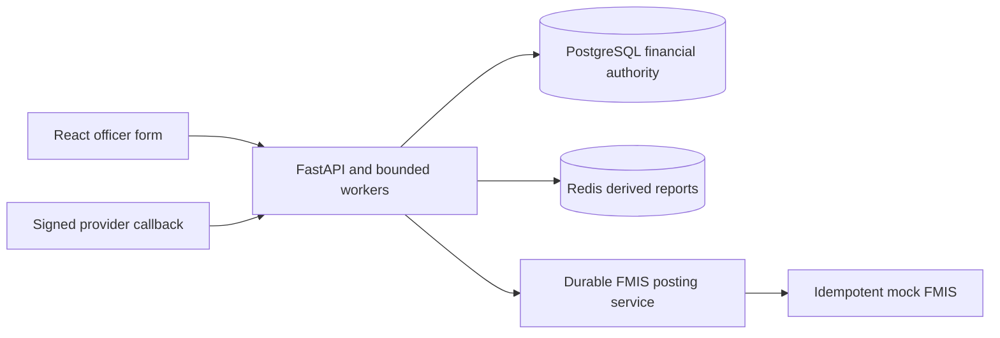

# IRCUB · interview solutions

Runnable answers for **Section1 Technical Coding Questions** and a stakeholder-readable **Section3 Business Analysis & System Design** response to `Farsight_Africa_IRCUB_Answered.docx`. The Word file is the interview answer; this repository supplies implementation evidence. Section2 POC is deliberately excluded. Sections4–6 are outside this revision; their original Word content remains unchanged.

## Technology and architecture

Python3.13 / FastAPI, PostgreSQL16, psycopg parameterised SQL, Redis7, httpx; React19 / TypeScript / Vite; pytest, React Testing Library/Vitest and Playwright; Docker Compose. Python and the existing directory layout are retained at the candidate's request.



One modular API keeps financial controls inspectable. Uniqueness, request recovery and penalty history are protected in PostgreSQL; Redis never owns transaction state. Separate mock FMIS is an external-system simulator, not a microservice decomposition. Section3 diagrams describe the future compliance module and are explicitly marked design-only.

## Repository

```text
Farsight_Africa_IRCUB_Answered.docx
README.md / TEST-REPORT.md
docs/                         question map, review plan, decisions/evidence
section_01_technical/
  database/                   migrations, seeds, query entry points
  backend/                    Python modules, config and README
  frontend/                   React app, unit/E2E tests and README
section_03_system_design/     FR/NFR, scope, model, stories and diagrams
tests/                       Python unit + isolated PostgreSQL integration tests
scripts/                     credential setup, local launch, smoke, diagram/Word tools
infrastructure/              backend/frontend Dockerfiles
docker-compose.yml
```

## Prerequisites and quick start

Docker Engine/Desktop with Compose v2 running; Python3.13 for credential generation and native tests; Node22.21+ for frontend development/tests. Ports5432,6379,8000,8001,5173 must be free. Docker build needs internet for images/dependencies; after build no real provider credentials/accounts are needed.

From the repository root:

```sh
python scripts/setup.py
docker compose up --build -d
docker compose ps
```

`setup.py` creates random local-only credentials in ignored `.env`; preserves existing values. First run initializes PostgreSQL schema and seed data. Only synthetic payer/reference data is included. Open the form and copy `OFFICER_API_KEY` from `.env` into its session credential field. Provider HMAC secret never goes to the browser.

| Service | URL |
|---|---|
| Frontend | http://localhost:5173 |
| Swagger / officer API authorisation | http://localhost:8000/docs |
| Backend health | http://localhost:8000/health |
| OpenAPI JSON | http://localhost:8000/openapi.json |
| Mock FMIS Swagger / health | http://localhost:8001/docs / http://localhost:8001/health |

Stop with `docker compose down` (data retained). Existing volumes do not reapply bootstrap migrations. Never discard volumes merely to fix an application error.

## Database, backend and frontend setup

- [Database README](section_01_technical/database/README.md): exact schema/seed setup, SQL calls, penalty assumptions, index/partition trade-offs and EXPLAIN.
- [Backend README](section_01_technical/backend/README.md): native Python environment/launcher, configuration, Swagger, curl/HMAC examples, queue/idempotency, FMIS and cache behaviour.
- [Frontend README](section_01_technical/frontend/README.md): npm installation, API URL, development/build, tablet journey, receipt and tests.

Native alternative from root: create/activate a Python virtualenv, `python -m pip install -r section_01_technical/backend/requirements.txt`, `docker compose up -d postgres redis`, then run `python scripts/run_backend.py --fmis` and `python scripts/run_backend.py` in separate terminals. In `section_01_technical/frontend`, run `npm ci` and `npm run dev`. Choose either native or container API/frontend to avoid port collisions.

## Validation

```sh
# root, Python dependencies installed; PostgreSQL/Redis running
python -m pytest -q
python scripts/smoke.py
# frontend directory
npm ci
npm run build
npm run lint
npm test
npx playwright install chromium
npm run e2e
```

See [TEST-REPORT.md](TEST-REPORT.md) for executed commands/results, corrected failures and limitations. Integration tests create disposable isolated databases and require the local test role's CREATE DATABASE capability. They never modify the demonstration ledger. Live smoke/E2E intentionally add unique synthetic demonstration payments. Unit-only: `python -m pytest -m 'not integration' -q`.

## Traceability and design decisions

[Question-to-code map](docs/interview-question-map.md) covers every Section1 question and Section3 task, including tests and how to run. [Implementation review](docs/implementation-plan.md) records original gaps. [System design](section_03_system_design/README.md) provides 23 functional requirements, measurable proposed NFRs, two architecture audiences, models, four stories, six flows and five actor journeys.

Important decisions: explicit water-account bill link avoids duplicated billed principal; payments aggregate before efficiency joins; database unique external_ref protects concurrent callbacks; durable per-item results allow safe partial-bulk recovery; report-version key invalidation avoids stale cache repopulation; persistent FMIS membership/stable keys handle ambiguous timeouts. Trade-offs: global report-version row and FMIS lock favour simple correctness over maximum throughput; API-key officer authentication keeps Section1 demonstrable without implementing the Section2 role POC.

## Assumptions and security boundaries

USD only. UTC report/FMIS day boundaries. Three actual consumption intervals require four cumulative actual readings; explicit rollover flag prevents treating invalid lower readings as a rollover. Penalties use started month anniversaries and current-unpaid snapshot recalculation; these assumptions are spelled out in component READMEs. Proposed Section3 agency time zone/notice/approval rules are separately identified assumptions.

Random secrets outside source control; constant-time HMAC checks and timestamp/replay controls; parameterised SQL; numeric/Decimal money; DB constraints and transactions; structured logs with correlation IDs; officer-only registry/report/read/post routes. Local ports bind loopback. This local demonstration does not provide production OIDC, per-object officer permissions, TLS termination, gateway rate limiting, secure audit export or production DB roles. Deploying beyond localhost requires those controls; they are not disguised as delivered features.

## Known limitations

No compliance enforcement implementation or Section2 modules. UI collections are unallocated; optional assessment_id in callbacks demonstrates allocation of principal only. Tariff source is local configuration rather than an administrator UI. No real bank, SMS/email or FMIS integration. No 50M-row benchmark, load/HA/backup drill or accessibility certification. The demo database role is an initialization/test role; production requires least privilege. Browser uncertain-request identity is in memory and requires reconciliation if the page is closed. Details and actual validation limits are in TEST-REPORT.md.

## AI assistance declaration

AI-assisted development tools were used to support implementation, code review, documentation and test generation. The candidate is responsible for reviewing the final submission, understanding the design decisions and explaining the code. The execution evidence records checks performed during this assisted session; it does not claim the candidate has already personally reviewed or independently validated every change. Before submission, the candidate should complete that review and confirm the declaration in the Word document.

## 10–15 minute interview demonstration

1. 0–2min: question map, scope and schema constraints; explain why external_ref uniqueness lives in PostgreSQL.
2. 2–4min: quarterly SQL/zero quarters and multi-payment efficiency; run penalty twice and inspect one daily history row.
3. 4–6min: Swagger water boundaries, rollover and configured estimation; show unit tests.
4. 6–9min: tablet form search/add two lines/receipt; duplicate reference rejection; explain safe retries.
5. 9–12min: signed callback smoke, concurrent duplicate test, Redis cache hit/invalidation and outage behaviour.
6. 12–15min: post/reconcile FMIS, explain accepted-timeout mode, then use Section3 business payment flow to explain cancellation/reconnection and technical transaction boundaries.
