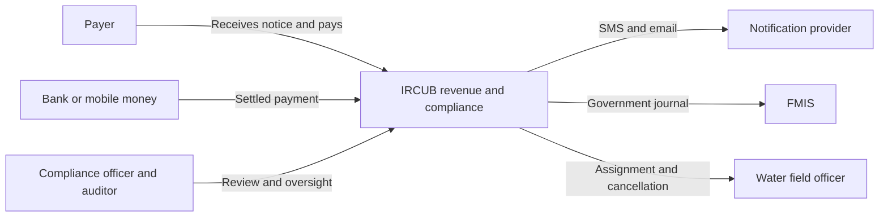

# Architecture and decisions

## Executive view

The Ministry owns tax rules and oversight; the Water Agency owns notice/disconnection policy. IRCUB coordinates debt and action. Payment confirmation stops eligible enforcement as soon as funds are verified and allocated; FMIS posting can finish independently.

## Technical boundaries

See `diagrams/technical-architecture.mmd` and SVG. External providers are untrusted until authenticated/validated. The API is the public boundary; database and Redis stay on a private network. OIDC tokens identify people; provider credentials authenticate integrations. Durable outbox jobs connect module transactions to notification and FMIS workers.

| Decision | Reason | Trade-off |
|---|---|---|
| Modular application with registry, billing, payment, compliance and work-order modules | Shared ledger transaction can atomically clear debt and stop enforcement | Module boundaries need disciplined ownership; deployment remains shared |
| PostgreSQL as financial authority | Constraints and row locks serialize duplicate/allocation decisions | DB capacity and backup/restore are operational priorities |
| Transactional outbox for proposed compliance jobs | A commit cannot clear debt but lose cancellation/notification intent | At-least-once delivery requires consumers to deduplicate |
| Rule versions and time snapshots | Explain which policy produced a notice or decision | More data and explicit migration policy for existing cases |
| Redis only for derived reports | Cache outage cannot block payment correctness | Version checks still need a small DB read; cached reports are not ledgers |
| Separate field order version checks | Prevent stale downloads from authorising disconnection after payment | Offline drafts cannot be finalised without server reconciliation |
| FMIS stable batch ID and lookup | Handle accepted-but-timed-out journal without a second posting | Real FMIS must contractually support idempotency/lookup; otherwise manual review |

Audit records are immutable to ordinary application roles and exported to protected storage. Database administrators can still alter local tables; “append-only” alone is not tamper-proof. Cryptographic chaining plus external anchors detects privileged changes. Production security/availability targets are proposed, not capabilities of the Section 1 local API-key demo.
