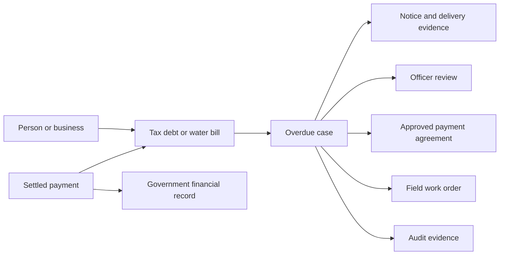

# Data model

The assessment's payer, assessment, payment, water_account and meter_reading remain authoritative. This proposed model extends them; `data_model.sql` is design-only and is not applied by Compose.

| Entity | Plain-English purpose | Important integrity rule |
|---|---|---|
| Payer | Person/business responsible for a debt | Unique TIN; contacts verified separately |
| Assessment | One tax or water obligation with due date and balance | Water assessment links an explicit account; numeric money |
| Water account | One service connection/meter | Belongs to one payer; no payer-only bill joins |
| Payment / allocation | Settled collection and the debt it reduces | Provider external reference unique; allocation cannot exceed available payment |
| Overdue case | Tracks action on an unpaid obligation | One active case per assessment; policy version preserved |
| Notification | Notice/reminder and delivery evidence | Business dedupe key by case/template/version/channel |
| Escalation | Assignment and decision trail | Unique case/level; auditor read-only |
| Payment plan | Approved agreement for staged settlement | Independent approver; versioned debt quote |
| Plan instalment | Amount/date promised in the agreement | Sum matches plan total; payment allocations track settlement |
| Work order | Assigned field action and outcome | At most one active order of each type per case; optimistic version |
| Audit record | Evidence of who decided what and when | Append-only permission boundary; protected export |

Business model:

Technical model is exported as `diagrams/technical-erd.svg` and supplied as Mermaid in `diagrams/technical-erd.mmd`. Add `payment_allocation(payment_id,assessment_id,amount)` for plans spanning debts; this is a proposed extension beyond the Section 1 single-assessment payment. Allocation and balance/work-order decisions use one transaction. Outbox events carry IDs and correlation, not SMS destination data; workers load necessary details with least privilege.
